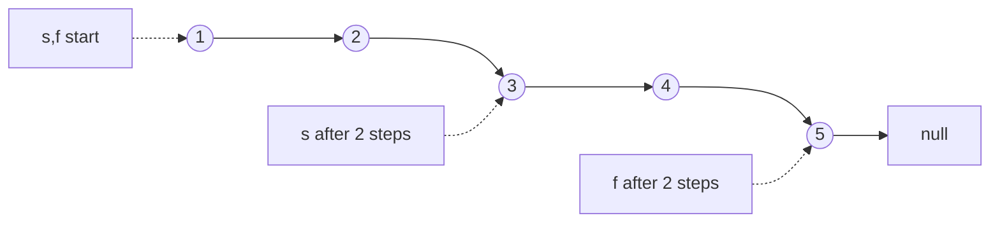

## fast-slow

**Motivation.** Linked list has no length, no index. Only `next`. So "find the middle" or "k-th from end" seems to need two passes: count, then walk. Fast/slow does it in one pass.

Idea: two walkers from the same start, one moves 2x. When the fast one hits the end, the slow one is halfway. Distances are ratios, not counts.

**Trace, odd length.** Step: `s = s->next`, `f = f->next->next`. Stop when `f` or `f->next` is null.

```
1 → 2 → 3 → 4 → 5 → null
s
f
```

`s` lands on 3.

**Trace, even length.** Same rule.

```
1 → 2 → 3 → 4 → null
s
f
```

`s` lands on 3 = second middle (LC 876 wants this one). First-middle variant: stop when `f->next` or `f->next->next` is null, `s` lands on 2.



**Invariant.** After the loop, s has taken exactly half as many steps as f. f at end ⇒ s at middle. f and s meet ⇒ cycle.

**When it applies.** Anything you can only step forward through: linked lists, arrays treated as `next = nums[i]` (LC 287), function iteration (LC 202 happy number). Two uses: middle / k-th from end (f finishes, s at known fraction), and cycle detection (f laps s and they meet; no cycle, f hits null). Examples: 141, 142, 876, 19.

## read-write

**Motivation.** Task: remove or compact elements in an array, in place, O(1) extra space. Naive: erase each match, shifting everything after it. O(n²). Or copy kept ones to a new array. O(n) space, and the problem forbids it.

Fix: two indices on the same array. `read` scans every element once. `write` is the next free slot for a kept element. Kept elements get copied down; junk gets overwritten later. Works because `write ≤ read` always, so writing never destroys something not yet read.

**Trace (LC 27).** Input `[3 2 2 3]`, val 3. Wanted: `[2 2 _ _]`, return 2. The `_` slots can hold anything, grader only reads first 2.

Rule: if `nums[r] != val`, `nums[w] = nums[r]; w++`. Always `r++`.

```
r=0  nums[0]=3  skip                 [3 2 2 3]  w=0
r=1  nums[1]=2  keep → nums[0]=2     [2 2 2 3]  w=1
r=2  nums[2]=2  keep → nums[1]=2     [2 2 2 3]  w=2
r=3  nums[3]=3  skip                 [2 2 2 3]  w=2
```

Return `w` = 2. First two slots `[2 2]`. The trailing `2 3` is garbage nobody reads.

**Invariant.** nums[0..w) is exactly the keepers seen so far, in order. w <= r always, so a write never clobbers unread data.

**When it applies.** Filter or compact in place, keep order: 27 (remove element), 26 / 80 (dedupe sorted), 283 (move zeros), 443 (string compression). Signal: "in place", "O(1) extra space", "return new length".
